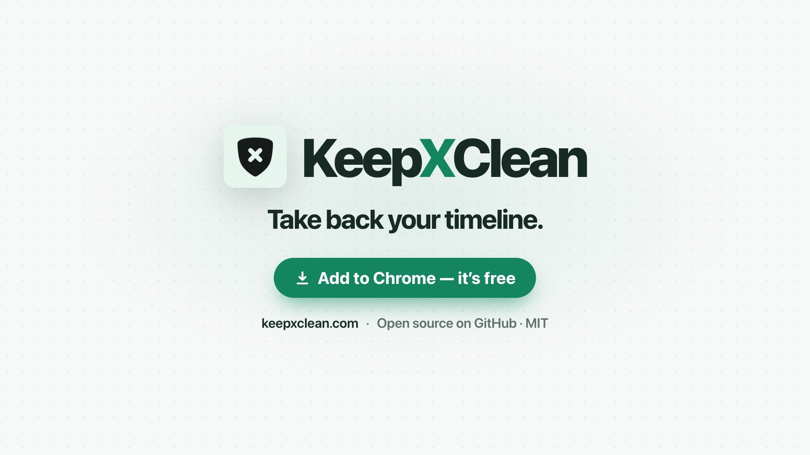

<div align="center">
  
  <h1>KeepXClean</h1>
  <p><strong>Local-first, high-signal timeline &amp; reply filter extension for X (Twitter)</strong></p>

  <p>
    <a href="https://chromewebstore.google.com/detail/keepxclean/plngcinmibjmkjjpfjemhfabjfjjkhhd"></a>
    <a href="https://keepxclean.com"></a>
    <a href="https://x.com/linheitu"></a>
    <a href="https://30s.to/@linmo"></a>
    <a href="LICENSE"></a>
    <a href="https://github.com/KeepXClean/keepxclean/actions/workflows/deploy.yml"></a>
  </p>

  <p>
    <strong>English</strong> ·
    <a href="docs/readme/README.zh-CN.md">简体中文</a> ·
    <a href="docs/readme/README.zh-TW.md">繁體中文</a> ·
    <a href="docs/readme/README.ja.md">日本語</a> ·
    <a href="docs/readme/README.ko.md">한국어</a> ·
    <a href="docs/readme/README.es.md">Español</a> ·
    <a href="docs/readme/README.pt.md">Português</a> ·
    <a href="docs/readme/README.fr.md">Français</a> ·
    <a href="docs/readme/README.de.md">Deutsch</a> ·
    <a href="docs/readme/README.ru.md">Русский</a>
  </p>
</div>

---

**KeepXClean** filters spam, reply bots, lookalike impersonators, engagement bait, crypto shilling, and promoted ads on X (`x.com`) in under **1 ms** — directly inside your browser with local filtering and optional X account actions.

<div align="center">

<a href="https://keepxclean.com/#video">
    
  </a>
  <p><a href="https://keepxclean.com/#video"><strong>▶ Watch the 30-second promo video on keepxclean.com</strong></a></p>

</div>

## Highlights

- **Local-First, `< 1ms` Engine & Parse Health Self-Check**: Evaluates tweet payloads already delivered to your browser via X's own GraphQL streams with zero new extension permissions (`storage` + `alarms` only), zero account login, zero extra X API polling, smooth 60/120 FPS scrolling, and pure-local X GraphQL parse health self-checks (alerts with redacted diagnostic copy if X changes schemas, auto-recovers, zero telemetry).
- **Comprehensive Noise Defense**:
  - Reply-section anti-flood, **same-thread duplicate reply spam** (normalized exact-match dedup keeping the 1st reply), Blue-verified low-effort bot replies, bio link funnels, and OP lookalike impersonator detection.
  - **Grok interaction control**: Protects official `@grok` replies from high-frequency false positives by default across all presets, with optional short `@grok` reply-summon filtering and opt-in hiding of Grok replies.
  - Engagement/giveaway bait, mutual-follow rings, high-frequency daily/burst posters, `#hashtag` / `$cashtag` stuffing, and **structured external-link domain filtering** (root + subdomain matching across tweet and author bio URLs with quote/RT penetration).
  - **10-language public keyword packs (45 built-in rules)** (`universal` + 9 regional language packs, whole-pack and per-rule toggles + copy to custom regex), custom multi-scope rules, **offline shareable `.kxc-pack.json` topic rule packs** (file/clipboard import & export, isolated uninstall), language allow/block lists, and promoted-ad removal.
- **Per-Scene Modes, Folded Bar Deep-Link & One-Click Restore**: Distinguish **For You** vs. **Following** feeds with per-scene modes (`inherit` / `collapse` / `strip` / `bypass` across `For You`, `Following`, `Replies`, and `Search`), quote/RT penetration, and expanded collapse-bar actions to jump straight to adjust the matched rule or disable a specific item in one click.
- **Quick-Start Onboarding, Rule Analytics & Optional Sync**: Non-intrusive first-install quick-start card (zero auto-opened tabs), clickable **per-rule stats + 7-day trend + pure-local Canvas 2D Battle Report PNG** (zero PII), **4.5-second undo window** with honest 3-phase status, and **opt-in `chrome.storage.sync`** (default OFF; rules/domains/packs sync across devices while large local blocklists, allowlists, and logs remain on device).
- **10 Native UI Languages & Chrome/Firefox MV3**: Built-in support for `en`, `zh-CN`, `zh-TW`, `ja`, `ko`, `es`, `pt`, `fr`, `de`, and `ru`.

## Installation

### Option 1: Chrome Web Store (Recommended)

Install in 1 click from the [**Chrome Web Store**](https://chromewebstore.google.com/detail/keepxclean/plngcinmibjmkjjpfjemhfabjfjjkhhd) — compatible with Google Chrome, Microsoft Edge, Brave, Arc, and other Chromium desktop browsers.

### Option 2: Manual Sideload (`.zip`)

1. Download the latest `keepxcleanextension-*-chrome.zip` from [**GitHub Releases**](https://github.com/KeepXClean/keepxclean/releases/latest) and unzip it.
2. Open `chrome://extensions` and enable **Developer mode**.
3. Click **Load unpacked** and select the extracted folder.

## Privacy & Security

- KeepXClean does not request passwords or DMs. It reads X account cookies locally for account identification and user-triggered X operations. Session cookies and web-client authorization values are used only with X, never sent to KeepXClean servers. Optional community reporting is described in the privacy policy.
- **Opt-In Defaults & Device-Local Lists**: On fresh install, `syncNativeXBlock`, `enableCrowdReport`, and optional cross-device sync (`chrome.storage.sync`) all default to **OFF**; optional sync excludes large local blocklists, allowlists, and history, and local parse health diagnostics contain zero PII and send zero telemetry.
- **Zero Telemetry**: No third-party analytics SDKs, ad trackers, or remote code execution.
- **Anonymous Community Sync**: Optional snapshot downloads (`credentials: 'omit'`) and one-way salted `SHA-256` reporter hashes for vote deduplication.
- Read the full bilingual [**Privacy Policy**](https://keepxclean.com/privacy/).

## Repository Structure & Development

```text
packages/shared/   Deterministic rule engine, X GraphQL parser, 10-language public packs (45 rules), offline pack validator & i18n
apps/extension/    WXT (Manifest V3 — Chrome & Firefox) extension, Shadow DOM UI, Canvas 2D Battle Report & background jobs
apps/server/       Cloudflare Workers API, D1 vote aggregation, snapshot cache & maintainer cloud-rules CLI
apps/web/          Official website & interactive browser sandbox (keepxclean.com)
tests/e2e/         5-tier virtual-DOM scenario & adversarial verification suite
tests/browser-e2e/ Real Chromium MV3 extension E2E suite
```

Requires **Node.js ≥ 20** and **pnpm**:

```bash
pnpm install
pnpm dev:ext      # Launch extension in development mode
pnpm lint         # Run ESLint across the workspace
pnpm typecheck    # Typecheck all workspace packages
pnpm test         # Run unit & integration tests (shared, extension, server, web)
pnpm test:e2e     # Run 5-tier scenario & adversarial test suite
pnpm build        # Production build across workspace
pnpm test:browser # Run real Chromium MV3 extension E2E
```

For release history, see [CHANGELOG.md](CHANGELOG.md). For Cloudflare Workers / D1 self-hosting, maintainer `cloud-rules` CLI, and CI/CD release configuration, see [docs/DEPLOYMENT.md](docs/DEPLOYMENT.md).

## Author & License

- **Author**: X [@linheitu](https://x.com/linheitu) · [30s.to/@linmo](https://30s.to/@linmo)
- **License**: Released under the [MIT License](LICENSE). KeepXClean is an independent open-source project and is not affiliated with X Corp.
