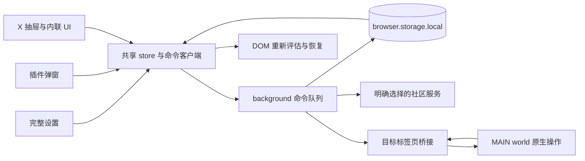

# KeepXClean 浅色 UI 完整实现方案

版本：1.1 · 2026-11-10 · 状态：P0–P6 产品代码已实现，本地自动检查与 Ego 样本验收通过；真实扩展 / X 外部接口联调待完成。

实际改动、检查证据与限制见 [实现与验收记录](verification/README.md)，运行界面见 [截图集](verification/index.html)。下文保留原方案作为实施基线，不能将其中的验收要求自动视为已验证事实。

本方案把 [11 张设计稿](index.html) 落到现有 WXT 扩展中，覆盖五个设置页面、插件弹窗、X 内设置抽屉、信息流交互，以及保存、导入、同步、失败和撤销流程。所有按钮都需要连接真实业务状态；PNG 仅作视觉参考。

## 1. 已确定的方向与实施边界

- **浅色界面**：白色内容面板、浅灰绿背景、绿色主要操作。扩展自己的界面始终为浅色；不修改 X 原生界面的主题和按钮颜色。
- **品牌图标**：浅绿纯色底 `#EAF6EF` + 黑钛 X，使用[已选图标包](icon-concepts/official-x/selected-black-titanium/README.md)。不要保护圈、光弧、内外分色、星芒或盾牌。早期画板中的盾牌占位图标全部替换。
- **业务基础**：继续使用现有规则引擎、预设、GraphQL 解析器、React 19、Tailwind CSS 4、Lucide 和 WXT。默认仍为 `standard` 预设、`strip` 直接隐藏模式。
- **本轮完整范围**：完成视觉替换，也完成设计稿新增的编辑、预览、反馈、异常恢复和可访问性。已有的错误状态不能继续藏在新外观后面。
- **不扩大为产品重写**：不新增账号系统、远程查人服务、收费系统、云端配置同步或新的过滤维度。社区计票服务的身份可信度不能通过改 UI 获得；界面不宣称“已核实风险”或“全网真实人数”。
- **交付平台**：先以现有 Chrome MV3 生产构建为验收目标；Firefox 只有单独完成构建和运行验证后才能标记支持。

视觉和行为的依据依次为：项目 `AGENTS.md` → 本方案的明确交互定义 → 设计变量 → PNG 的排版参考。图片中的人物、数字和示例数据不能写入生产默认值。

## 2. 实施前代码基线与当时待解决的问题

2026-11-10 已执行：`pnpm test` 通过 10 项测试（shared 9、server 1），`pnpm typecheck` 通过，`pnpm build` 通过 Chrome MV3 构建。本机锁定安装的 WXT 为 0.19.29。这些结果只证明实施前基线通过，**不代表新 UI 或浏览器交互已经验收**。

| 现有入口 | 已有能力 | 实施时必须处理 |
| --- | --- | --- |
| [`options/App.tsx`](../../apps/extension/entrypoints/options/App.tsx) | 四个标签页、规则、关键词、名单和日志 | 拆为五页；增加关键词编辑、导入预览、偏好页；全量旧配置覆盖、保存失败、重置清空名单等问题 |
| [`popup/App.tsx`](../../apps/extension/entrypoints/popup/App.tsx) | 总开关、预设、快速关键词、最近记录 | 三种主要状态、真实同步结果、加载失败、400 px 布局、与完整设置共享状态 |
| [`content.ts`](../../apps/extension/entrypoints/content.ts) | DOM 隐藏、折叠条、主页标签、抽屉、净空提示 | 当前字符串 HTML/CSS 与业务混合；抽屉捕获旧配置；关闭后不完整恢复 DOM；缺少异步结果确认 |
| [`background.ts`](../../apps/extension/entrypoints/background.ts) | 消息、快照、上报、撤回、批量导入 | 成为唯一写入者；区分各阶段结果；取消反复点原因就乐观加票、静默跨服务提交和虚构上报身份 |
| [`page-interceptor.content.ts`](../../apps/extension/entrypoints/page-interceptor.content.ts) | MAIN world 拦截、X 原生操作、读取黑名单 | 给原生操作补结果与超时；缺少 CSRF 时也返回失败；黑名单分页；过滤与 UI 生命周期分离 |
| 原 `storage.ts`（已由 [`background/repository.ts`](../../apps/extension/src/background/repository.ts) 替换） | 本地配置、快照、日志和统计 | 区分“不存在”和“读取失败”；串行写入；迁移；避免多入口读改写丢数据 |
| [`engine.ts`](../../packages/shared/src/engine.ts) | 七类规则、豁免、决策 | 保留既有顺序；补可选的命中时证据；DOM 重新评估不能重复记录或改写历史事实 |
| [`server/src/index.ts`](../../apps/server/src/index.ts) | 快照、单条与批量上报 | 使用实际 `countedPublicly` / `isNewVote` / `importedCount`；必要时补契约测试，不能把 HTTP 200 等同于已计公共票 |

实施前的 manifest 尚未接入选定图标，HTML、CSS 存在深色背景；本次已统一替换。

## 3. 页面与设计稿的逐项映射

完整设置采用 hash 导航，无需新增路由库。刷新、浏览器前进后退、弹窗跳转和日志跳转规则都要可用。未知 hash 回到过滤规则。

| 页面 / 入口 | 设计稿 | 主要内容 | 建议模块 |
| --- | --- | --- | --- |
| `#/rules` 过滤规则 | 01、02 | 总开关、三档预设、自定义标记、呈现方式、七类规则、两项豁免 | `RulesPage`、`RuleRow`、`RuleDetail` |
| `#/keywords` 关键词 | 03、11 | 自定义词库、公共词库、搜索、编辑、开关、删除 | `KeywordsPage`、`KeywordEditor` |
| `#/accounts` 黑白名单 | 04、11 | 本地黑名单、白名单、社区快照、手动添加、X 黑名单导入 | `AccountsPage`、`AccountEditor`、`ImportWizard` |
| `#/history` 拦截记录 | 05、11 | 今日与累计、筛选、记录详情、加白、广告规则入口、清空 | `HistoryPage`、`LogDetail` |
| `#/preferences` 偏好设置 | 06、10 | X 同步、社区共享、公共词库、快照状态、服务地址、备份和重置 | `PreferencesPage`、`ConfigImportDialog` |
| 工具栏弹窗 | 07、10 | 开启 / 暂停 / 暂无记录、快捷设置、近期记录、完整设置入口 | `PopupApp`、`QuickControls` |
| X 内设置抽屉 | 08、10 | 同一套快捷设置、简要统计、导入入口、完整设置入口 | `SettingsDrawer` |
| X 信息流和主页 | 09、10 | 折叠条、展开、加白、快捷净空、原因、撤销、主页提示 | `CollapseBar`、`QuickBlockButton`、`OperationToast`、`ProfileBadges` |
| 跨页面状态 | 10、11 | 加载、离线、错误、校验、空数据、无搜索结果、完成反馈 | 共用基础组件和状态组件 |

### 3.1 过滤规则

页面顶部显示总状态与保存状态；暂停时允许编辑配置，并说明“恢复过滤后生效”。预设仅调用现有 `applyPreset` 的覆盖边界，保留自己的关键词、名单和偏好。手动改变预设管理的规则参数后标为“自定义”，不假装仍完全符合某个预设。

| 规则 | 要提供的控件 | 必须准确的说明 |
| --- | --- | --- |
| 高频账号 | 启用、历史日均阈值、滑动窗口开关、窗口小时数与数量阈值 | 历史日均来自总推文数 / 注册天数；滑动窗口统计本浏览器观察到的不同推文，不是账号实际近一小时总发布数 |
| 社区记录 | 启用、计数阈值、高粉保护说明 | 5 万粉及以上的账号使用 5 倍门槛；展示当前快照记录数及更新时间，不承诺实时或已核实 |
| 自定义关键词 | 启用、已启用词条数、进入词库 | 此开关控制自定义词条；公共词库是独立开关，不能用一个开关的外观暗示两者都关闭 |
| 蓝标回复 | 启用、仅回复区、低粉门槛、纯表情 / 短回复开关、最短长度 | 说明实际受粉丝数和场景约束；具体边界沿用引擎，不能写成“所有短回复均隐藏” |
| 标签刷屏 | 启用、Hashtag 与 Cashtag 数量阈值 | 两种标签分别统计 |
| 账号质量 | 启用、最低注册天数、回复区默认头像、关注比例、最小关注数 | 默认头像和账号年龄判断还有粉丝条件；详情同步解释引擎实际条件 |
| 推广广告 | 启用、说明 | 广告规则优先于白名单与关注豁免；详情不提供无效的“给广告作者加白以恢复广告” |

数值控件用“数值输入 + 需要时的滑杆”，共享单位、边界、步长和校验。滑杆展示范围不等于存储值的完整合法范围：历史配置中的合法大值不能仅因超出滑杆范围被截断。输入过程保留草稿，失焦、Enter 或滑杆释放后提交；非法值不写入，也不自动变成 0。开关即时提交。

### 3.2 关键词

- 自定义词库支持搜索、启停、编辑、删除；新建和编辑用同一个表单，以稳定 `id` 更新，保留顺序。搜索覆盖表达式与备注，筛选结果显示数量。
- 表单字段：内容、普通文字 / 正则、正文 / 简介 / 昵称与 Handle / 链接四种范围、粉丝豁免、备注、启用。至少选择一个范围；空内容不可提交。普通文字按字面匹配，不要求用户转义。
- 正则校验与现有引擎一致，使用 `new RegExp(pattern, 'i')`；提示填写表达式本体而非 `/表达式/flags`。校验只能证明语法有效，不声称消除了所有复杂表达式的运行风险。本轮不改变正则语义。
- 粉丝豁免提供独立开关：关闭映射为现有的 `undefined` / 0 语义，开启后必须为正整数。可展示“粉丝数达到该值时跳过此关键词”。
- 公共词库只读，可搜索，展示来源和快照状态，使用 `enableCloudKeywords` 控制整体启用；不提供单条编辑和删除。偏好页与本页的开关绑定同一字段。
- 删除显示词条内容的短预览；失败保留条目和编辑内容。快速添加复用校验与提交服务，不再另写一套保存逻辑。

### 3.3 黑白名单与 X 黑名单导入

三个标签为本地黑名单、白名单、社区记录。前两者可管理，社区只读；搜索和分页在本地完成，不为补齐头像或用户名向 X 发请求。社区快照只有 UID、计数和标签时直接显示 UID，不能生成虚假的 Handle。

手动添加要求数值 UID（沿用服务端 1–25 位数字约束），Handle 和名称仅作可选展示信息；只有 Handle 不足以创建持久账号记录。黑白名单互斥，迁移到另一名单的含义在确认文案中写清。删除本地名单只改变本地过滤，不自动解除 X 原生拉黑，也不把未知的公共票据当作本次操作撤回。

导入流程统一用于完整设置和 X 抽屉：

1. **选择 X 标签页与读取**：抽屉使用当前标签页；完整设置优先使用唯一可用 X 标签页，多标签页时选择目标。未打开或未登录时提供打开 X 的入口，不把失败当成空名单。结果绑定标签页与当前 X 账号。
2. **分页获取**：对现有读取接口补游标遍历；校验每页结构、游标是否前进、UID 是否有效，支持取消和超时。如果接口不支持或失效，明确结束为失败或部分读取，不能显示“全部已读取”。
3. **预览**：显示读取到的去重总数、新增、已在本地、与白名单冲突、无效记录数。默认保留白名单并跳过冲突；用户可明确选择把冲突项移入黑名单。提交时再次基于最新配置计算差异。
4. **共享选择**：“同时提交社区”默认不勾选；全局社区共享关闭时不可提交，并指向偏好设置。导入本地无需开启 X 原生同步，也不对已经读取的账号再逐个调用 X 拉黑。
5. **执行**：所有有效选中 UID 在一次本地配置提交中保存；不得默默只保存前 500 个。超过浏览器存储配额则显示实际失败，不能给出虚假成功数。社区请求按服务端每批最多 500 个分批，展示进度、失败批次与可重试项。
6. **结果**：分别展示本地新增、跳过、社区新计入、未计入和失败。`importedCount` 不是本地导入数；`countedPublicly: false` 不等于请求失败。服务端没有细分原因时也不能猜成“重复”。

关闭向导可取消尚未开始的读取和请求；已经完成的本地保存与已提交的远端结果保留，不暗示取消会回滚全部操作。大批量导入任务由 background 管理，关闭弹窗后可在完整设置查看结果；原始待导入 UID 临时存放，任务结束后清理。

### 3.4 拦截记录

- 顶部“今日”“累计”来自统计存储；列表是最近最多 200 条，不用列表长度冒充累计数量。按文本、规则、场景筛选，可分页，区分“尚无记录”和“没有符合筛选条件的记录”。
- 详情显示命中时的账号、场景、摘要、原因和时间。新增可选 `RuleEvidence`，保存命中时的观测值与实际门槛；旧日志只有 `reasonText` 时只展示已有原因，不能套用今天的新阈值伪造当时证据。
- 引擎按顺序产生主要命中原因；不把未评估的其他规则画成同时命中。主页风险标签与真正隐藏 / 折叠的记录分开理解。
- 普通账号日志可加白；推广日志只给“调整广告规则”。加白成功指本地列表更新，不代表取消 X 拉黑。若内容已被 `strip` 从响应移除，提示刷新才能重新加载。
- “在 X 查看”使用有效推文 ID 构造链接，不插入未经校验的任意 URL。缺少 ID 时不显示可点击的失效操作。
- 清空前确认“仅清空最近记录，保留累计统计”；成功后更新所有入口，失败保留原列表。
- 将“今日”改为设备本地自然日，并保留旧累计值。旧 UTC 日统计不能可靠重算本地日时，升级当天标为“今日（升级后）”，次日恢复正常标题；不得凭 200 条历史日志推算完整今日总数。

### 3.5 偏好、快照与备份

偏好页承接 `syncNativeXBlock`、`enableCrowdReport`、`enableCloudKeywords` 和 `customApiBaseUrl`。各开关解释影响的操作；关闭社区共享不关闭本地过滤，关闭 X 同步不阻止本地加黑。

快照同时区分“最近成功拉取时间”“数据生成时间”“来源”。内置默认数据不是刚同步的网络数据；读取失败时保留最后可用缓存，并显示“使用缓存”和重试。更新按钮依据实际 `ok` 结果结束，不能只在回调触发时显示成功。

JSON 导入导出采用以下确定边界：

| 操作 | 行为 |
| --- | --- |
| 导出 | 继续输出可识别的 `FilterConfig` v1，包括自定义词条、黑白名单和偏好；不导出日志、当前 X 身份、认证数据、待执行任务。文件名包含日期 |
| 读取文件 | 本轮交互导入上限 10 MiB；明确显示上限。JSON 解析、完整结构校验、版本检查与字段归一化在写入前完成 |
| 兼容 | 支持现有合法 v1 配置；缺失可选字段补默认值。未知更高版本、错误类型、非法 UID / 数值 / 正则给出字段路径与原因；不静默覆盖 |
| 预览 | 显示规则、关键词、黑白名单和偏好的变化数量；明示“将替换本地配置”，提供先导出当前配置的入口 |
| 应用 | background 再校验一次；检查预览基于的配置摘要是否已变化，有变化就刷新预览；一次写入，失败保留原配置 |
| 服务权限 | 导入中的新服务地址也要完成地址校验及浏览器权限检查，拒绝权限则不进行整包替换，不保留半份导入结果 |
| 远端副作用 | 导入只替换本地配置，不补发历史社区上报，不对名单逐个调用 X 拉黑 |

“重置过滤设置”定义为：恢复标准预设管理的规则参数、默认呈现方式、关注 / 主页豁免，以及自定义关键词总开关；**保留自定义关键词条目、总启停、黑白名单、X 同步 / 社区共享 / 公共词库偏好、服务地址、记录和统计**。确认框列明这一边界。本轮不提供清空全部数据的混合重置按钮。

服务选择只使用用户明确选择的服务：默认生产服务可以在同一服务的 CDN / API 间读取快照；自定义服务失败时不能偷偷向生产或 localhost 提交。自定义地址要求 HTTPS，明确的本地开发地址可用 HTTP；拒绝带账号密码的 URL。按所选 origin 在用户操作时申请可选 host 权限，取消或拒绝时保留原设置。localhost 自动回退只允许显式开发配置。

### 3.6 插件弹窗与 X 抽屉

- 弹窗宽 400 CSS px、最大高 600 px，顶部与底部入口保持可达，中间滚动。打开时先显示加载态，随后根据真实状态展示开启 / 暂停 / 无记录；无记录不隐藏其他可用设置。
- 共用总开关、预设、呈现方式、快照状态和最近 5 条记录。暂停时可修改配置，但用明确文案说明恢复后生效；不把暂停画成离线错误。
- 快速关键词沿用当前语义：普通文字、正文与简介范围、2 万粉豁免；输入旁简要说明，提供“更多选项”进入完整编辑器。添加成功后才清空输入。
- 抽屉宽 `min(440px, 100vw)`，支持关闭按钮、Escape、遮罩关闭、焦点回到来源按钮和背景滚动锁定；存在未提交的编辑草稿时由对应表单处理，不能静默丢弃。
- 抽屉每次显示当前状态，禁止继续捕获打开瞬间的 `cfg` 并在多次操作中反复覆盖。完整设置入口能带具体页面 hash。
- X 原生导航按钮的可用性随页面和布局检测；宿主节点不存在时不伪造大型导航。抽屉入口、工具栏弹窗都能继续使用。

### 3.7 信息流、主页与快捷净空

折叠条显示一条主要原因，支持临时展开 / 收起与加入白名单。展开只影响当前条目的展示，不关闭规则。重复扫描不能插入第二条折叠条；X 复用 DOM 节点展示另一条推文时必须移除旧状态并重新判断。

主页标签写成“历史日均约 N 条”“社区快照记录 N 次”等可验证信息；无命中可写“未命中当前规则”，不写“信誉正常”。缺少账号数据就不显示该指标。主页仅提示的开关应按引擎实际结果工作。

快捷净空采用一个可追踪操作，三个阶段独立记录：

| 阶段 | 交互与结果 |
| --- | --- |
| 本地处理 | 校验真实 UID，保存操作前的本地状态；成功写入本地黑名单后隐藏相应内容，提示“已加入本地黑名单”。写入失败恢复界面并提供重试 |
| 撤销窗口 | 保留现有约 4.5 秒窗口；这段时间暂不发起 X 拉黑和社区上报。原因选择只更新本次操作；撤销恢复该操作之前的本地状态并取消尚未提交的外部动作 |
| 外部提交 | 撤销窗口结束后，按偏好分别尝试 X 拉黑和社区上报；UI 显示“X 同步中”“社区提交中”，收到实际结果后分别结束 |
| 部分失败 | 例如“本地已保存 · X 同步失败 · 社区未开启”。只重试失败阶段，保留操作 ID，不重新隐藏、重复计数或重复创建一条操作 |
| 结果未知 | 超时只代表未确认，显示“结果未确认”；不能据此显示“未拉黑”或自动执行解除拉黑。关闭 X 标签页、账号改变等都要形成可理解的结果 |

这会把 X 同步和社区提交推迟约一个撤销窗口，换取明确的撤销边界。外部阶段开始后撤销按钮失效；之后从名单移除只恢复本地过滤，不自动解除可能早已存在的 X 拉黑。撤销本地写入还要检查该 UID 是否被其他入口随后修改，不能覆盖更晚的用户操作。

待执行操作持久化最小任务信息和截止时间；background 正常运行时用定时器，并登记恢复用 alarm，在服务工作线程重新唤醒时恢复未完成任务。不能保证 MV3 工作线程休眠期间精确在 4.5 秒执行，也不能为此常驻保活。目标标签页丢失或身份变化时暂停相应 X 操作，给出重新操作入口。操作历史与详情提供后续结果，不能依赖一个瞬时 Toast。

用户直接在 X 原生菜单拉黑时，只在确认原生请求成功后进行相应社区处理；扩展自己发起的原生请求带内部关联标识，避免再被观察器当作新操作重复上报。无法识别当前用户时不使用伪造的匿名 UID、账号年龄或粉丝数补齐社区资格。

## 4. 视觉系统、图标与可访问性

实施时以 [`tokens.css`](tokens.css) 为初始值，在 `apps/extension/src/ui/tokens.css` 建立运行时代码唯一来源。图库继续保留设计参考，不让两套运行时主题并行维护。

| 项目 | 规范 |
| --- | --- |
| 背景 / 面板 | `#F7F9F8` / `#FFFFFF` |
| 主文字 / 辅助文字 | `#172B24` / `#607168` |
| 品牌绿 / 悬停 / 选中底 | `#13865F` / `#0F6E4E` / `#EAF6EF` |
| 分隔线 / 控件边框 | `#E1E7E3` / `#A7B5AD`；分隔线不能替代输入框可辨识边界 |
| 警告 / 错误 | `#9B6816` + `#FFF6DF` / `#B54747` + `#FFF0EE`；同时有文字或图标 |
| 字号 | 辅助 12、正文 14、区块 18、页标题 28 px；系统中文字体 |
| 间距与圆角 | 4 / 8 / 12 / 16 / 24 / 32 px；控件 8、面板 12 px；常规控件高 36 px |
| 布局 | 桌面侧栏 224 px；小于 1000 px 收窄侧栏、详情转抽屉；小于 720 px 改顶部导航，五页入口均可达 |
| 列表 | 本地列表与日志默认每页 25 条；长文本省略并可查看完整值；窄屏改卡片或表格内部横向滚动，不能让整个页面溢出 |
| 动效 | 颜色和面板切换 120–180 ms；尊重 reduced-motion；不加金属旋转、光圈等品牌动效 |

图标接入：

1. 从已选包复制 `icon-16/32/48/128.png` 到扩展 `public/icon/`，注册 manifest `icons` 与 `action.default_icon`；设置页和弹窗注册 favicon。24 / 64 / 256 / 512 / 1024 保留为其他展示及交付尺寸。
2. 品牌 `BrandIcon` 根据尺寸使用小尺寸光学校正版或主 SVG，不能把 512 版直接压成 16 px 造成线条糊成一团。SVG 是黑钛参考图的矢量重建，材质反射与生成图有细微差别。
3. 功能图标使用现有 `lucide-react` 命名导入，统一 16 / 18 / 20 px、约 1.75 描边、`currentColor`；不再用 emoji 或另一枚盾牌充当品牌。装饰图标隐藏于读屏，纯图标按钮必须有可访问名称。

基础组件包括 `Button`、`IconButton`、`Switch`、`SegmentedControl`、`NumberField`、`TextField`、`FieldError`、`Panel`、`Table`、`Pagination`、`EmptyState`、`Skeleton`、`StatusBanner`、`Dialog`、`Drawer`、`Toast`、`BrandIcon`。优先原生表单语义；弹层管理焦点、Escape、回焦和滚动锁。阴影 DOM 中的弹层挂到同一个隔离容器，不把 Portal 丢到 X 的 `document.body`。

验收包含键盘 Tab / Shift+Tab、开关 Space、Enter 提交、标签与错误关联、可见焦点、状态读屏、200% 缩放、长中文内容和减少动态效果。正文对比度目标 4.5:1，必要控件边界与焦点目标 3:1；现有浅色 focus ring 只作辅助，另加清晰轮廓，实测不达标就调整。

## 5. 代码结构与共享状态

保留入口文件负责启动，页面、业务服务和 DOM 接入分别拆开。以下为拟新增结构，不表示文件已经存在：

```text
apps/extension/
├── public/icon/                         # manifest 图标
├── public/brand/                        # 页面使用的 SVG
├── src/ui/
│   ├── tokens.css                      # 运行时设计变量
│   ├── components/                     # 基础组件
│   └── layout/                         # SettingsShell / PageHeader
├── src/features/
│   ├── rules/                          # RulesPage / RuleDetail
│   ├── keywords/                       # 词库 / 编辑器
│   ├── accounts/                       # 名单 / 导入向导
│   ├── history/                        # 日志 / 详情
│   ├── preferences/                    # 备份 / 服务设置
│   └── quick-controls/                 # 弹窗与抽屉共享内容
├── src/state/                          # external store / selectors / hooks
├── src/services/                       # messages / client / validation
├── src/background/                     # commands / repositories / jobs / sync
├── src/content/
│   ├── ui/                             # React 浮层与内联组件
│   ├── dom-controller.ts               # 查找、隐藏、恢复、节点复用
│   ├── decision-cache.ts               # 已知推文与配置变更重评
│   └── main-bridge.ts                  # MAIN 请求与结果校验
└── entrypoints/                        # options / popup / content / MAIN / background
```

无需为这次重构引入新的状态库、整套组件库或路由框架。使用 React `useSyncExternalStore` 与小型共享 store：配置、快照、同步元信息、统计、日志分别缓存和订阅，避免任何 storage 变化都重读全部数据。表单草稿留在组件中，持久状态来自同一服务层。



### 5.1 唯一写入入口

所有配置、名单、日志、统计、同步元信息和操作任务通过 background 写入；其他上下文只读和发命令。background 收到命令后排队读取最新状态、执行转换、校验并保存，再返回持久化结果。

- 传递 `setEnabled(true)`、`setRuleField(...)`、`upsertKeyword(id, ...)` 等语义命令，不传页面捕获的整个旧配置，也不传在重试时会反向的 `toggle`。
- 不相关字段可顺序合并；同一字段以队列最后成功提交的值为准。复杂对象编辑附原对象摘要，发现另一窗口已修改时提示冲突，不无提示覆盖。
- 需要替换全配置的 JSON 导入 / 重置使用明确命令，并校验预览时的版本摘要。使用同一 local storage 对象保存原子配置结果。
- UI 可先展示选中态和“保存中”，只有提交成功才显示“已保存”；失败恢复最后确认值并保留草稿。用请求序号隔离旧响应，避免晚到的失败回滚更新的成功。
- 快速连续输入合并尚未提交的相同字段；组件卸载不能丢掉已经向 background 提交的写入。

### 5.2 消息与结果契约

在 `src/services/messages.ts` 定义可辨别联合类型，三个入口复用。以下是接口形状，具体命令参数以领域类型展开，不能最终落成任意字符串路径和 `any`：

```ts
type Result<T> =
  | { ok: true; requestId: string; data: T }
  | { ok: false; requestId: string; error: {
      code: 'VALIDATION' | 'STORAGE' | 'CONFLICT' | 'PERMISSION'
        | 'NO_SESSION' | 'ACCOUNT_CHANGED' | 'TIMEOUT'
        | 'NETWORK' | 'INVALID_RESPONSE';
      message: string;
      retryable: boolean;
    }};

type StageStatus =
  | 'not_requested' | 'pending' | 'running' | 'succeeded'
  | 'not_counted' | 'failed' | 'unknown' | 'cancelled';

interface OperationReceipt {
  operationId: string;
  targetUid: string;
  undoUntil?: number;
  local: StageStatus;
  nativeX: StageStatus;
  community: StageStatus;
  // 各阶段另存错误、服务端返回和关联标签页，不用一个 ok 覆盖整项操作。
}
```

至少提供配置字段更新、预设、词条增改删、名单迁移、配置预览 / 应用、规则重置、日志清空、快照刷新、黑名单读取 / 导入、开始净空、修改原因、撤销与失败阶段重试等命令。对外部任务返回任务 ID，进度通过存储订阅获取，避免长流程绑定弹窗寿命。

MAIN 桥接统一包含命令、`requestId`、目标 UID 和结果；请求必须结束于成功、明确失败或超时。没有 CSRF、非预期 HTTP 状态、解析失败、网络错误均返回结果。DOM CustomEvent 只是页面与扩展之间的传输方式，不能当成可信认证边界；校验消息结构、当前目标和账号关联，不把 Cookie 或令牌写入日志 / UI 状态。

### 5.3 存储、迁移与数据真实性

- `FilterConfig.version = 1` 和现有配置 key 继续兼容；新增验证与归一化，不能把读取异常当成初次安装并覆盖默认配置。确实不存在时才初始化默认值。
- 损坏配置先保留原始值的本地恢复副本，显示“读取配置失败”与恢复入口；不能悄悄抹掉用户名单。可识别的旧字段按明确迁移补齐，非法导入整体拒绝。
- 新增独立同步元信息：状态、最近尝试、最近成功、来源、快照生成时间、最后错误。快照 `updatedAt` 不再冒充本机同步时间。
- 统计采用可迁移的新 key / 版本，携带旧累计数并明确本地日切换；清空日志不清统计。日志和统计在同一串行事务中更新；DOM 重渲染、展开和配置重评不能重复增长。
- 可选日志证据向后兼容；对每种规则记录必要的数值和范围即可，不额外收集完整推文、Cookie 或个人数据。
- 当前 X 账号以标签页会话为依据，不能用全局最后一个 viewer 覆盖所有标签页；任务开始和提交前校验一致性，缺失身份时只做允许的本地操作。
- 待执行任务仅保留恢复所需数据；终态操作收据最多保留最近 100 条或 7 天，先达到者清理。不要把整个黑名单复制进每条日志。

## 6. X 页面样式与 DOM 生命周期

使用已安装 WXT 的 `createShadowRootUi` 和 `cssInjectionMode: 'ui'` 隔离扩展样式。抽屉、Toast、Dialog 共用一个 React 根；内联折叠条、按钮和标签通过注册容器 + Portal 挂载，避免每条推文创建一套独立应用。样式资源共享，事件隔离只覆盖扩展控件，不能吞掉 X 的正常点击和滚动。

扩展页面可使用基础 reset，注入 X 的样式只能作用于 Shadow DOM；清理原 `injectStyles` 的全局深色选择器。变量定义同时覆盖扩展页面根与 Shadow host，字体、颜色和 `color-scheme: light` 显式设定。

DOM 控制器负责以下行为：

1. 维护宿主节点、推文 ID、扩展插入节点和隐藏状态的注册关系；通过扩展专属 class / 属性隐藏，恢复时只移除自己的状态，不覆盖 X 原有 inline style。
2. 配置 / 快照改变后，用最新配置重新评估缓存的推文信息，清掉过期决策。重复评估不重复喂入滑动窗口或计日志；计数仍按已观察到的不同推文。
3. 关闭过滤、加入白名单、切换模式时恢复仍在 DOM 中的内容并清理折叠标记。对已经从 GraphQL 响应中剔除、没有数据可恢复的内容，显示刷新提示。
4. MutationObserver 只处理新增、变更或复用的宿主节点，跳过扩展自身变更，并按帧合并；不因每次 UI 更新全页面扫描全部文章。
5. SPA 导航、节点卸载、WXT context 失效时，解除监听、取消定时器、卸载 Portal / React 根并清理页面修改。主页切换必须更新账号标签。
6. MAIN world 的 GraphQL 拦截保留独立生命周期；UI 关闭不卸载网络拦截，关闭过滤通过配置实现放行。不要在同一次视觉重构中无依据更改 GraphQL 路径处理。

## 7. 社区服务对接与边界

当前服务响应足够区分多数 UI 状态，优先使用现有契约：

| 返回 / 情况 | 展示与处理 |
| --- | --- |
| 单条 `countedPublicly: true, isNewVote: true` | 社区已计入本次记录；使用服务器返回的计数 |
| `isNewVote: false` | 已有记录 / 原因已更新；不再次增加快照计数 |
| `countedPublicly: false` | 提交已处理但未计入公共统计；有明确原因时显示原因 |
| 批量 `importedCount` / `totalSubmitted` | 分别作为社区新计入和有效提交数量；不替代本地保存数量 |
| 超时 / 非法响应 | 保留本地结果，远端状态失败或未确认；不盲目显示已同步 |
| 未开启共享 / 缺少可靠身份信息 | 跳过社区阶段，不伪造账号年龄或匿名投票身份 |

移除 background 对公共快照计数的无依据乐观加减。单次原因调整复用同一操作，最多提交最终选择；已经提交后更新原因也使用同一账号与目标关系，不能新建一票。远端结果与快照可能有缓存延迟，界面分别显示操作收据和快照时间，不强行让两者看起来实时一致。

服务端已有的“投票表 + 聚合计数”分步写入、标签聚合和客户端自报身份属于独立正确性边界。为新 UI 开启自动重试前，必须用实际 D1 行为验证幂等性和并发一致性；发现计数漂移则先修事务 / 聚合逻辑，再启用该路径重试。UI 不应为了实现外观而扩张为完整身份系统，但也不能对未经验证的数据作信誉担保。

## 8. 实施顺序、文件改动与阶段出口

以下阶段构成同一项完整工作，P1 的外观骨架不等于整个新 UI 已完成。每阶段完成后必须可运行，避免一次替换全部入口后才排查问题。

| 阶段 | 具体工作与主要文件 | 完成条件 |
| --- | --- | --- |
| P0：状态与数据契约 | 新增 `services/messages.ts`、校验、background 仓储与命令队列；改 `storage.ts` / `background.ts`；补迁移和有意义的并发测试 | 两个入口同时改不同字段不丢数据；失败不假成功；原配置可读；无静默重置 |
| P1：视觉基础与品牌 | 新增 `src/ui`、`public/icon`、`public/brand`；更新 `global.css`、两处 HTML、`wxt.config.ts`；实现设置壳与五页导航 | 五页壳、所有基础状态可见；manifest 和 favicon 使用无保护圈黑钛 X；没有残留深色主体 |
| P2：完整设置 | 拆分 `options/App.tsx`；完成规则、词库、名单、记录、偏好及所有 Dialog | 01–06、10–11 对应的交互真实可用；导入失败不覆盖；重置符合定义；导航可直达 |
| P3：工具栏弹窗 | 重写 `popup/App.tsx`，复用 `QuickControls`、列表与状态组件 | 07 的开启 / 暂停 / 空状态齐全；400 × 最多 600 px；跨入口同步无覆盖 |
| P4：X 内组件 | 拆 `content.ts`，加入 Shadow DOM UI、抽屉、内联组件、DOM 生命周期和配置重评 | 08–09 外观与基本交互完成；X 明暗主题不串色；关闭过滤恢复可恢复内容；无重复注入 |
| P5：外部流程闭环 | 改 MAIN 桥接、操作任务、导入分页 / 分批、服务权限、社区真实结果；需要时修 server 契约 | 原生操作有确认；撤销不误解封；导入数量准确；账号切换 / 关闭页面 / 超时不假成功 |
| P6：整体验收与交付 | 增补 extension 测试脚本、回归、Ego 浏览器 QA、生产构建和图标校验；更新 README 的实际行为说明 | 下表全部必验项通过；无未处理核心流程；交付可加载构建、截图、检查结果和已知限制 |

依赖关系：P0 → P1 → P2 → P3；P4 使用已稳定的 P0/P1 组件；P5 的契约设计在 P0 确定，P4/P5 完成后进入 P6。实现过程中不升级整个工具链来混入无关变量。

重点修改现有文件：

- `entrypoints/options/App.tsx` / `popup/App.tsx` 变为组合入口，保留 `main.tsx` 启动结构。
- `entrypoints/content.ts` 只组织初始化、订阅和 controller，不再保存大段 UI HTML。
- `entrypoints/background.ts` 负责路由命令，领域执行移入 `src/background/`。
- `entrypoints/page-interceptor.content.ts` 保留拦截，补充严格的请求结果和任务关联。
- `packages/shared/src/types.ts` 增加可选证据类型，必要时 `engine.ts` 返回命中证据；保持原规则判断和测试。
- `apps/extension/package.json` 增加可运行的测试脚本；根 `test` 脚本纳入 extension，避免新测试没有被 CI / 本地总入口执行。
- `apps/server/src/index.ts` 仅在结果契约或重试一致性确有缺口时修改，不为页面排版改数据库结构。

## 9. 验收矩阵

| 范围 | 必须覆盖的场景 | 通过标准 |
| --- | --- | --- |
| 设计覆盖 | 01–11 全部画板对应页面、子页、弹层和状态 | 都有真实组件与可操作路径；不遗漏公共词库、社区 UID 表和失败状态 |
| 保存与并发 | 设置页 / 弹窗 / 抽屉连续修改；慢响应、写入失败、关闭弹窗 | 不覆盖无关字段，不用旧响应回滚新值，只有持久化成功才显示已保存 |
| 规则回归 | 七类规则、预设、关注豁免、主页、广告、白名单、高粉保护 | 与原引擎契约一致，默认 strip 未改变；UI 文案与实际计算一致 |
| 关键词 | 普通文字、合法 / 非法正则、无范围、豁免、同 ID 编辑、搜索 | 无效内容不可保存；编辑不重复新增；公共词库只读且独立开关 |
| JSON | 合法旧 v1、缺字段、错误类型、更高版本、超大文件、预览后配置变更 | 明确原因；确认前不写；失败原数据完整；服务权限拒绝不会半导入 |
| 名单导入 | 空名单、未登录、部分分页失败、重复游标、501+ UID、重复 / 白名单冲突 | 不把失败当空；本地数量准确；共享可选；远端批次结果可追踪 |
| 净空与撤销 | 已有本地黑名单、原生状态未知、改原因、立即撤销、窗口到期、重复点击 | 恢复操作前状态；无重复票；撤销窗口内不发外部动作；不误解除旧 X 拉黑 |
| 外部结果 | X 成功 / 失败 / 无 CSRF / 超时；社区未计入 / 已存在 / 失败；账号切换 | 三阶段各有真实状态；未知结果不冒充成功或失败；禁用共享时不发送 |
| DOM 恢复 | 开关、加白、strip / collapse 切换、节点复用、SPA 跳转 | 清理自有隐藏与标记；不能恢复的剔除内容提示刷新；无双按钮 / 双折叠条 |
| 日志统计 | 重复扫描、跨本地午夜、旧统计升级、清空记录、旧日志无证据 | 不重复增长；今日口径真实；累计保留；旧详情不显示伪造阈值 |
| 隔离与响应式 | X 浅色 / 深色、设置页 1440 / 1024 / 768 / 390 px、弹窗 400 px | 没有全局样式污染、内容截断或不可达操作；drawer 适配视口 |
| 无障碍 | 键盘、回焦、读屏状态、缩放 200%、长中文、reduced-motion | 关键流程无需鼠标可完成；错误可定位；焦点清楚且不被浮层困住 |
| 图标与生产包 | 16 / 32 / 48 / 128 PNG、favicon、manifest、离线启动 | 均为浅绿底黑钛 X；无保护圈；资源存在、尺寸正确、无远程图标依赖 |

自动化测试重点放在真实失败边界：语义命令合并、迁移、完整配置校验、导入计数、阶段状态机、超时、撤销和 DOM 恢复。共享引擎沿用并补充必要回归；不为颜色值或 JSX 结构逐一写镜像测试。组件交互使用适合 React 的 DOM 测试环境；浏览器验收统一使用 Ego，先用脱敏固定样本验证状态，再验证真实扩展环境。

真实 X 联调前先完成模拟成功 / 失败回执，避免为了截图随意拉黑或向社区写入真实账号。测试数据不包含真实 Cookie、认证头或完整用户身份；外部动作联调使用明确的测试目标与开发服务。

运行入口应包括：

```bash
pnpm test
pnpm typecheck
pnpm build
```

补齐 extension 的测试接入后，这三个命令才成为新 UI 的整体自动检查入口。生产包还需要在 Ego 中加载验证，构建成功不能代替 DOM、权限弹窗或 X 原生接口的实际检查。

## 10. 交付与回退

最终交付物：运行时代码、选定品牌资源、可加载的 Chrome MV3 构建、11 组覆盖截图 / 状态记录、测试结果、迁移说明及实际存在的限制。更新 README 中旧的深色示例、立即同步 / 一键导入等已改变的描述；不得仍用文档承诺未实现的流程。

实施前导出一份当前配置；迁移采用新增元信息 key 和向后兼容字段，保留旧数据供恢复。旧版本降级前先停止尚未执行的外部任务，不能让旧 UI 不认识的任务继续提交。回退不自动撤销已经成功的 X 或社区操作。

验收后才生成发布用压缩包。写好发布说明与检查结果不等于自动发布商店或部署生产服务；本方案本身不触发这些外部操作。

## 11. 尚待运行环境验证的事实

这些不影响开始实现本地页面，但必须在宣布完整交付前给出真实结果：

- X 当前版本对现有原生拉黑、解除拉黑、黑名单游标接口的实际响应与权限要求。
- Ego 加载扩展后的 Shadow DOM 挂载、SPA 节点复用、工具栏弹窗、权限申请与焦点行为。
- 多账号 X 标签页的身份关联，不能依赖当前全局 viewer 存储作为证明。
- D1 下重复 / 并发提交和撤回的实际聚合一致性；现有一项 server 测试不足以证明。
- 上线服务的快照字段与响应形状是否完全符合本地类型；客户端必须验证后再使用。

P0–P6 所列实现范围已落地。42 项自动化测试、类型检查与 Chrome MV3 构建已通过，Ego 中完成了生产组件的本地样本验收。真实 X 接口、已加载扩展的权限及多账号行为尚未验收，未发布商店或部署线上服务；最终状态以 [验收记录](verification/README.md) 为准。
