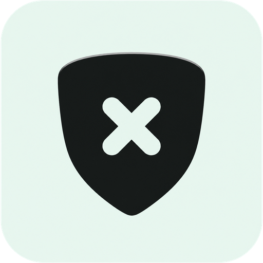

<div align="center">
  
  <h1>KeepXClean</h1>
  <p><strong>ローカルファースト・高シグナルな X（Twitter）タイムライン＆リプライ浄化拡張機能</strong></p>

  <p>
    <a href="https://chromewebstore.google.com/detail/keepxclean/plngcinmibjmkjjpfjemhfabjfjjkhhd"></a>
    <a href="https://keepxclean.com/?lang=ja"></a>
    <a href="https://x.com/linheitu"></a>
    <a href="https://30s.to/@linmo"></a>
    <a href="../../LICENSE"></a>
    <a href="https://github.com/KeepXClean/keepxclean/actions/workflows/deploy.yml"></a>
  </p>

  <p>
    <a href="../../README.md">English</a> ·
    <a href="./README.zh-CN.md">简体中文</a> ·
    <a href="./README.zh-TW.md">繁體中文</a> ·
    <strong>日本語</strong> ·
    <a href="./README.ko.md">한국어</a> ·
    <a href="./README.es.md">Español</a> ·
    <a href="./README.pt.md">Português</a> ·
    <a href="./README.fr.md">Français</a> ·
    <a href="./README.de.md">Deutsch</a> ·
    <a href="./README.ru.md">Русский</a>
  </p>
</div>

---

**KeepXClean** は、ブラウザがすでに受信した X（`x.com`）の GraphQL レスポンスをローカルメモリ上で直接解析し、インプレゾンビ・なりすまし・懸賞誘導・暗号資産スパム・プロモーション広告を **1 ms 未満** で遮断するオープンソース拡張機能です。

<div align="center">

<a href="https://keepxclean.com/?lang=ja#video">
    
  </a>
  <p><a href="https://keepxclean.com/?lang=ja#video"><strong>▶ 公式サイトで30秒プロモーション動画を見る</strong></a></p>

</div>

## 主な特長

- **完全ローカル処理・`< 1ms` エンジン＆解析ヘルス自己チェック**：追加権限ゼロ（`storage` + `alarms` のみ）、ログイン不要、追加 X API ポーリングゼロで 60/120 FPS を維持。X の仕様変更を端末内で検知し脱識別診断コピーを提供する解析ヘルス自己チェックも搭載（テレメトリゼロ）。
- **多層スパム防御**：インプレゾンビ短文リプライ、**同一スレッドのコピペ重複返信対策**、**公式 `@grok` 保護＆短文呼び出しフィルター**、なりすまし、懸賞誘導、高頻度連投、**外部リンクドメインフィルター**、**10言語パブリック辞書パック（全45ルール）**、**オフライン共有可能な `.kxc-pack.json` ルールパック**、言語フィルター、プロモ広告除去に対応。
- **シーン別表示＆折りたたみバー直接操作 + 引用貫通**：「おすすめ」と「フォロー中」を識別しシーン別モード（`inherit` / `collapse` / `strip` / `bypass`）を設定可能。折りたたみ展開から該当ルール設定への直接ジャンプや一致項目のワンクリック無効化・即時復元も備えています。
- **初回ガイド、ルール別統計＆任意の同期**：非侵入型の初回クイックスタートカード、ルール別内訳・7日間推移・**ローカル Canvas 2D 戦績レポート PNG**（個人情報ゼロ）、**4.5秒復元トースト**、初期オフの**任意 `chrome.storage.sync` 設定同期**（大容量ブロック一覧と履歴は端末内に保持）。
- **10言語ネイティブ対応＆Chrome / Firefox MV3**：日本語・英語・中国語（簡体/繁体）・韓国語・スペイン語・ポルトガル語・フランス語・ドイツ語・ロシア語を内蔵。

## インストール方法

### 方法 1：Chrome ウェブストアから導入（推奨）

[**Chrome ウェブストア**](https://chromewebstore.google.com/detail/keepxclean/plngcinmibjmkjjpfjemhfabjfjjkhhd) からワンクリックで追加できます（Chrome / Edge / Brave / Arc などのデスクトップ Chromium ブラウザ対応）。

### 方法 2：GitHub Releases から手動導入（`.zip`）

1. [**GitHub Releases**](https://github.com/KeepXClean/keepxclean/releases/latest) から最新の `keepxcleanextension-*-chrome.zip` をダウンロードして解凍します。
2. `chrome://extensions` を開き、右上の **デベロッパーモード** を有効化します。
3. **パッケージ化されていない拡張機能を読み込む** から解凍したフォルダを選択します。

## プライバシーとセキュリティ

- KeepXClean はパスワードや DM を要求しません。アカウント識別とユーザーが実行する X 操作のため、X の Cookie を端末内で読み取ります。セッション Cookie と Web クライアントの認証値は X との通信にのみ使用し、KeepXClean サーバーには送信しません。任意のコミュニティ報告についてはプライバシーポリシーをご覧ください。
- **安全な初期設定とローカル保持**：新規インストールでは `syncNativeXBlock`、`enableCrowdReport`、`chrome.storage.sync` 同期がいずれも初期状態 **OFF**。任意同期に大容量ブロックリストや履歴は含まれず、解析ヘルス診断も個人情報・テレメトリゼロです。
- **外部トラッキングゼロ**：サードパーティ解析 SDK や広告トラッカー、リモートコード実行は一切ありません。
- 詳細は公式バイリンガル [**プライバシーポリシー**](https://keepxclean.com/privacy/) をご覧ください。

## リポジトリ構成と開発コマンド

```text
packages/shared/   決定論的ルールエンジン、X GraphQL パーサー、10言語パブリック辞書パック（45ルール）、オフラインパック検証＆i18n
apps/extension/    WXT (Manifest V3 — Chrome & Firefox) ブラウザ拡張機能、Shadow DOM UI、Canvas 2D レポート＆バックグラウンド処理
apps/server/       Cloudflare Workers API、D1 集計、スナップショットキャッシュ＆メンテナ用 cloud-rules CLI
apps/web/          公式サイト＆インタラクティブ・ブラウザサンドボックス
tests/e2e/         5階層エンドツーエンド＆敵対的テストスイート
tests/browser-e2e/ 実 Chromium MV3 拡張機能 E2E テストスイート
```

必須環境：**Node.js ≥ 20**、**pnpm**

```bash
pnpm install
pnpm dev:ext      # 開発モードで拡張機能を起動
pnpm lint         # ワークスペース全体の ESLint チェック
pnpm typecheck    # 型チェック
pnpm test         # 単体・結合テストを実行
pnpm test:e2e     # 5階層 E2E テストを実行
pnpm build        # 本番ビルド
pnpm test:browser # 実 Chromium MV3 拡張機能 E2E を実行
```

変更履歴は [CHANGELOG.md](../../CHANGELOG.md) を、セルフホストおよび CI/CD 設定は [docs/DEPLOYMENT.md](../DEPLOYMENT.md) を参照してください。

## 作者とライセンス

- **作者**：X [@linheitu](https://x.com/linheitu) · [30s.to/@linmo](https://30s.to/@linmo)
- **ライセンス**：[MIT License](../../LICENSE) の下で公開されています。KeepXClean は独立したオープンソースプロジェクトであり、X Corp. とは無関係です。
